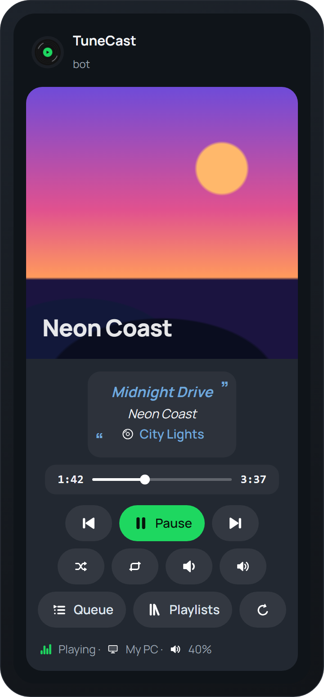

<div align="center">

**English** | [Русский](README.ru.md)


# TuneCast

**Control Spotify from Telegram**

Your personal remote bot: a player with album art, the queue, track search and playlists right in the chat.<br>
Runs on your own computer, no third-party servers.

[](../../releases/latest)




</div>

> [!TIP]
> The bot and the setup wizard speak **English** and **Russian**. Pick a language on first run and switch anytime with `/language`.

---

## Features

| | |
|---|---|
| ▶️ **Player in the chat** | A single message with album art, progress and colored buttons: pause, skip, shuffle, repeat, volume. It updates itself and doesn't clutter the chat. |
| 📜 **Queue** | The next 20 tracks in a neat table. |
| 🔎 **Search** | Send the bot a track name, then ➕ to queue it or ▶️ to play it right away. |
| 📚 **Playlists** | Your playlists and Liked Songs, plus any playlist, album or artist from a Spotify link. |
| 📱 **Devices** | Music plays wherever Spotify is open: PC, phone or speaker. Switch devices from the bot. |
| ✨ **Animated emoji** | With Telegram Premium the bot draws its own set of animated icons. Replace any of them with yours via `/emoji`. |
| 🎙 **Track in your profile** *(beta)* | Shows what's playing in your Telegram profile's music section — the "♪ Track — Artist" bar. |

Think [Spoticord](https://spoticord.com) for Discord, but for Telegram: the bot works as a remote for Spotify on your own devices.

## Quick start

1. Download **[TuneCast.exe](../../releases/latest)** and put it in any folder (e.g. `Documents\TuneCast`).
2. Run it. If Windows shows "Windows protected your PC", click **More info → Run anyway** (the app has no paid code-signing certificate).
3. Follow the setup wizard: it explains every step, opens the right pages for you and checks your keys.
4. Send `/start` to your bot.

**You'll need:** Windows 10/11, a Telegram account and **Spotify Premium** (Spotify doesn't allow playback control without it).

## Which keys the wizard asks for, and why

All keys are stored **only on your computer**, in `data/settings.env` next to TuneCast.exe. There is no TuneCast server: the app talks to Telegram and Spotify directly.

| What | Why | Where to get it |
|---|---|---|
| **Bot token** | The "password" of your personal bot: TuneCast uses it to receive and send messages. | [@BotFather](https://t.me/BotFather) → `/newbot` |
| **Your Telegram ID** | So the bot obeys only you. | Nothing to type: the wizard detects it when you press **Start** in your bot. |
| **Client ID and Client secret** | Spotify only allows playback control through a developer app. Your own app means your own limits. | [Spotify Dashboard](https://developer.spotify.com/dashboard) → **Create app**. Redirect URI: `http://127.0.0.1:8888/callback`, API: **Web API**. Keys are in **Settings**. |
| **api_id and api_hash** *(optional)* | Only for the track in your profile: a bot can't change your profile, only your own account can. | [my.telegram.org](https://my.telegram.org/apps) → **API development tools** |

To change settings later, run `TuneCast.exe --setup` (press Enter to keep the current value).

## Bot commands

| Command | What it does |
|---|---|
| `/start` | Open the player |
| `/queue` | Queue |
| `/playlists` | Playlists |
| `/devices` | Pick a device |
| `/emoji` | Replace icons with your own emoji |
| `/language` | Switch language (English / Русский) |
| `/help` | Help |

You can also just send a track name, or a link to a Spotify playlist, album, artist or track.

## Good to know

- **The bot runs while the TuneCast window is open.** The wizard can add it to Windows startup.
- **Animated emoji** are created once; the first time takes about 15 minutes because Telegram rate-limits sticker pack creation. Until then the bot uses regular emoji.
- **Spotify limitations (since 2026):** track lists are only visible for your own playlists, but you can play any playlist; search returns 10 tracks at a time (the "More" button loads the next page); Spotify doesn't allow removing tracks from the queue.
- **Track in your profile** is experimental. A silent track with the current title, artist and cover is uploaded to your profile's music section. Your own profile tracks are left untouched.
- **Never share the `data` folder**: it holds your keys and your Spotify login (and your Telegram login, if the profile track is enabled).

## Running from source

Requires Python 3.13.

```bash
git clone https://github.com/IvyL-L/TuneCast.git
cd TuneCast
python -m venv .venv
.venv\Scripts\pip install -r requirements.txt
.venv\Scripts\python -m tunecast
```

To build your own `TuneCast.exe`, run `build.bat`; the file will appear in `dist\`.

<details>
<summary>Project structure</summary>

```
tunecast/
  app.py            entry point: setup wizard, then the bot
  i18n.py           all texts in English and Russian
  botmeta.py        command menu and bot description
  setup.py          first-run setup wizard
  config.py         settings in data/settings.env
  spotify.py        Spotify Web API client and login
  panel.py          the player panel and its auto-refresh
  handlers.py       commands and buttons
  ui.py             layout of every screen (Rich Messages)
  emoji.py          emoji packs, custom replacements, non-Premium mode
  emoji_art.py      animated icons drawn in code (Lottie)
  profile_music.py  track in the profile's music section
  audio.py          silent MP3 for the profile
assets/             icon, logo and README images
tools/make_assets.py  generates the icon and logo
```
</details>

## License

[MIT](LICENSE). TuneCast is not affiliated with Spotify AB or Telegram FZ-LLC. Spotify is a trademark of Spotify AB.
