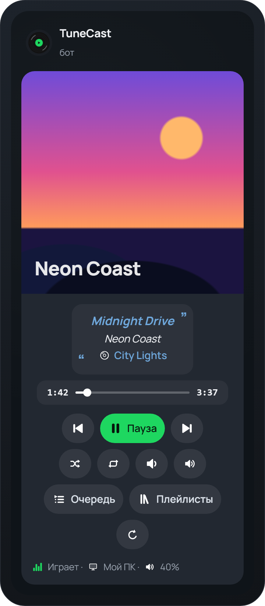

<div align="center">

[English](README.md) | **Русский**


# TuneCast

**Управляй Spotify из Telegram**

Личный бот-пульт: плеер с обложкой, очередь, поиск треков и плейлисты прямо в чате.<br>
Работает на твоём компьютере, без чужих серверов.

[](../../releases/latest)




</div>

---

## Что умеет

| | |
|---|---|
| ▶️ **Плеер в чате** | Одно сообщение с обложкой, прогрессом и цветными кнопками: пауза, переключение, перемешивание, повтор, громкость. Обновляется само и не засоряет чат. |
| 📜 **Очередь** | Следующие 20 треков аккуратной таблицей. |
| 🔎 **Поиск** | Напиши боту название трека, затем ➕ — в очередь, ▶️ — включить сразу. |
| 📚 **Плейлисты** | Твои плейлисты и «Любимые треки», а также любой плейлист, альбом или исполнитель по ссылке из Spotify. |
| 📱 **Устройства** | Музыка играет там, где открыт Spotify: на ПК, телефоне или колонке. Устройство можно переключить из бота. |
| ✨ **Анимированные эмодзи** | С Telegram Premium бот сам нарисует набор живых иконок. Любую можно заменить своей: команда `/emoji`. |
| 🎙 **Трек в профиле** *(бета)* | Показывает текущий трек в «Музыке профиля» — плашке «♪ Трек — Исполнитель» в твоём профиле. |

Похоже на [Spoticord](https://spoticord.com) для Discord, только для Telegram: бот работает как пульт для Spotify на твоих устройствах.

## Быстрый старт

1. Скачай **[TuneCast.exe](../../releases/latest)** и положи его в любую папку (например, `Документы\TuneCast`).
2. Запусти. Если Windows покажет «Система Windows защитила ваш компьютер» — нажми **Подробнее → Выполнить в любом случае** (у программы нет платной цифровой подписи).
3. Пройди мастер настройки: он объяснит каждый шаг, сам откроет нужные страницы и проверит ключи.
4. Напиши своему боту `/start`.

**Понадобится:** Windows 10/11, аккаунт Telegram и **Spotify Premium** (без Premium Spotify не разрешает управлять воспроизведением).

## Какие ключи спросит мастер и зачем

Все ключи хранятся **только на твоём компьютере**, в файле `data/settings.env` рядом с TuneCast.exe. Никакого сервера TuneCast нет: программа общается с Telegram и Spotify напрямую.

| Что | Зачем | Где взять |
|---|---|---|
| **Токен бота** | «Пароль» твоего личного бота: по нему TuneCast получает сообщения и отвечает. | [@BotFather](https://t.me/BotFather) → `/newbot` |
| **Твой Telegram ID** | Чтобы бот слушался только тебя. | Вводить не нужно: мастер узнает его сам, когда ты нажмёшь **Start** в боте. |
| **Client ID и Client secret** | Spotify пускает к управлению музыкой только через приложение разработчика. Своё приложение — свои лимиты. | [Spotify Dashboard](https://developer.spotify.com/dashboard) → **Create app**. Redirect URI: `http://127.0.0.1:8888/callback`, API: **Web API**. Ключи — в **Settings**. |
| **api_id и api_hash** *(по желанию)* | Только для трека в профиле: менять профиль может лишь твой аккаунт, а не бот. | [my.telegram.org](https://my.telegram.org/apps) → **API development tools** |

Поменять настройки: `TuneCast.exe --setup` (Enter оставляет текущее значение).

## Команды бота

| Команда | Что делает |
|---|---|
| `/start` | Открыть плеер |
| `/queue` | Очередь |
| `/playlists` | Плейлисты |
| `/devices` | Выбрать устройство |
| `/emoji` | Заменить иконки своими эмодзи |
| `/help` | Помощь |

А ещё можно просто написать название трека или прислать ссылку на плейлист, альбом, исполнителя или трек из Spotify.

## Полезно знать

- **Бот работает, пока открыто окно TuneCast.** В мастере можно включить автозапуск вместе с Windows.
- **Анимированные эмодзи** создаются один раз и в первый раз около 15 минут: Telegram ограничивает скорость создания паков. Пока они создаются, бот работает с обычными эмодзи.
- **Ограничения Spotify (с 2026 года):** список треков виден только у своих плейлистов, но включить можно любой; поиск выдаёт по 10 треков (кнопка «Ещё» листает дальше); удалять треки из очереди Spotify не разрешает.
- **Трек в профиле** — экспериментальная функция. В профиль загружается беззвучный трек с названием, исполнителем и обложкой того, что играет. Твои собственные треки в профиле не трогаются.
- **Никому не отправляй папку `data`**: в ней ключи и вход в Spotify (и в Telegram, если включён трек в профиле).

## Запуск из исходников

Нужен Python 3.13.

```bash
git clone https://github.com/IvyL-L/TuneCast.git
cd TuneCast
python -m venv .venv
.venv\Scripts\pip install -r requirements.txt
.venv\Scripts\python -m tunecast
```

Собрать свой `TuneCast.exe`: запусти `build.bat`, готовый файл появится в `dist\`.

<details>
<summary>Устройство проекта</summary>

```
tunecast/
  app.py            запуск: мастер настройки, затем бот
  setup.py          мастер первой настройки
  config.py         настройки в data/settings.env
  spotify.py        клиент Spotify Web API и вход
  panel.py          панель-плеер и её автообновление
  handlers.py       команды и кнопки
  ui.py             оформление всех экранов (Rich Messages)
  emoji.py          паки эмодзи, замена своими, режим без Premium
  emoji_art.py      анимированные иконки, нарисованные кодом (Lottie)
  profile_music.py  трек в «Музыке профиля»
  audio.py          беззвучный MP3 для профиля
assets/             иконка, логотип и картинка для README
tools/make_assets.py  генерация иконки и логотипа
```
</details>

## Лицензия

[MIT](LICENSE). TuneCast не связан со Spotify AB и Telegram FZ-LLC. Spotify — товарный знак Spotify AB.
